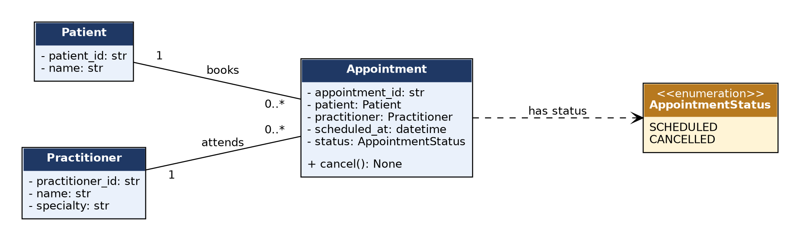

# SmartCare v0.3 - Domain Model Workbook

## Requirement-to-Concept Trace

| Requirement | Concept                            | State/behaviour                                                                                           | Decision                                                |
|-------------|------------------------------------|-----------------------------------------------------------------------------------------------------------|---------------------------------------------------------|
| FR-01       | Patient                            | patient_id, name; validated                                                                               | Keep                                                    |
| FR-02       | Patient                            | patient_id is the lookup key; the search itself is workflow, not Patient behaviour                        | Keep attribute; search moves to a service (Stage 5)     |
| FR-03       | Practitioner                       | practitioner_id, name, specialty                                                                          | Keep                                                    |
| FR-04       | Appointment + Practitioner         | availability is derived: no SCHEDULED appointment for that practitioner and time                          | Keep as derived; no Schedule class                      |
| FR-05       | Appointment                        | appointment_id, patient, practitioner, scheduled_at, status = SCHEDULED                                   | Keep                                                    |
| FR-06       | Appointment (rule across many)     | needs to compare practitioner and scheduled_at of all appointments; one Appointment cannot see the others | Keep data on Appointment; enforce in workflow (Stage 5) |
| FR-07       | Appointment                        | cancel(): SCHEDULED to CANCELLED; repeat cancel rejected                                                  | Keep                                                    |
| FR-08       | Appointment, AppointmentStatus     | object retained; status = CANCELLED                                                                       | Keep (enum)                                             |
| FR-09       | Practitioner - Appointment         | association 1 to 0..\*; viewing is a query                                                                | Keep association                                        |
| FR-10       | Patient - Appointment              | association 1 to 0..\*; history includes CANCELLED                                                        | Keep association                                        |
| FR-11       | Patient, Practitioner, Appointment | required-field validation when an object is created                                                       | Keep (implemented Stage 4)                              |
| FR-12       | AppointmentStatus                  | one enum used everywhere for consistent status                                                            | Keep                                                    |

## CRC Cards

### Patient

| Responsibilities                                              | Collaborators |
|---------------------------------------------------------------|---------------|
| Hold the patient's ID and name; require both to be valid      | Appointment   |
| Provide a stable identity (patient_id) for search and history | Appointment   |

### Practitioner

| Responsibilities                                                        | Collaborators |
|-------------------------------------------------------------------------|---------------|
| Hold the practitioner's ID, name and specialty; require all to be valid | Appointment   |
| Provide a stable identity (practitioner_id) for booking and schedule    | Appointment   |

### Appointment

| Responsibilities                                                    | Collaborators         |
|---------------------------------------------------------------------|-----------------------|
| Hold appointment_id, patient, practitioner, scheduled_at and status | Patient, Practitioner |
| Cancel itself (SCHEDULED to CANCELLED only) and remain as history   | AppointmentStatus     |

### Optional class

| Responsibilities                                                                         | Collaborators                      |
|------------------------------------------------------------------------------------------|------------------------------------|
| Clinic (considered and rejected): would own all patients, practitioners and appointments | Patient, Practitioner, Appointment |
| Not needed: no requirement uses it; collections are handled by repositories in Stage 5   | None                               |

## UML Class Diagram

Figure 1 - SmartCare v0.3 domain model (multiplicities: Patient 1 to 0..\* Appointment; Practitioner 1 to 0..\* Appointment).

## Design Rationale

Three core classes (Patient, Practitioner, Appointment) correspond directly to what the client asked for. AppointmentStatus is an enum because the requirements define exactly two named states.

Relationships: an Appointment refers to exactly one Patient and one Practitioner; each of them can have many appointments (1 to 0..\*). These are associations, not inheritance, because an appointment is not a kind of patient or practitioner.

Responsibilities: Appointment owns its own status rule because that rule is an invariant of the appointment. The rule that a practitioner cannot be double-booked involves many appointments, so it is not placed in one Appointment object; it is recorded for the workflow/service layer in Stage 5.

Exclusions: no Clinic, Manager, Controller or Notification classes and no database or UI concepts - none is supported by a requirement.

## AI Design Review Record

| AI suggestion                                      | Evidence                       | Decision       | Reason                                                          | Model change           |
|----------------------------------------------------|--------------------------------|----------------|-----------------------------------------------------------------|------------------------|
| AppointmentStatus enum                             | FR-07, FR-08: two named states | Accept         | Makes states explicit and prevents invalid values.              | Status becomes an enum |
| Clinic aggregate owning everything                 | No requirement                 | Modify (defer) | Collections can be held by repositories later.                  | No Clinic class        |
| Manager classes (Patient/Practitioner/Appointment) | Weak - no requirement          | Reject         | Add orchestration without a need and weaken the domain objects. | No change              |
| ClinicController                                   | None                           | Reject         | Premature application-layer class.                              | No change              |
| NotificationManager                                | None - no reminder requirement | Reject         | Unsupported feature.                                            | No change              |
| Inheritance between Patient and Appointment        | None                           | Reject         | Not an "is-a" relationship.                                     | Keep association       |
| Person superclass for Patient and Practitioner     | None - only name is shared     | Reject         | Adds hierarchy without shared behaviour.                        | No change              |
