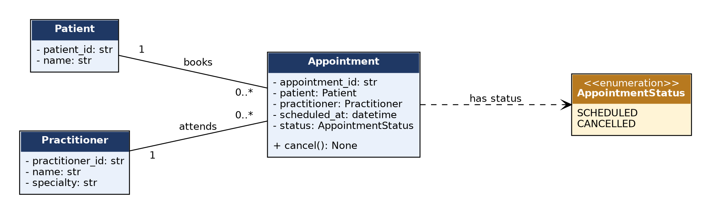

# Stage 3 Lab

AI OFF -> AI ON -> COMPARE -> VERIFY | 1 hour

## A - Requirements Review

Highlight nouns, verbs and business rules in SmartCare v0.2.

**Nouns:** patient, practitioner, appointment, status, history, schedule/availability, ID, name, specialty, time.

**Verbs:** create, search, book, cancel, retain, view, validate.

**Business rules:** an appointment has exactly one patient and one practitioner (A2); a practitioner cannot have two SCHEDULED appointments at the same time (FR-06); cancelling changes status to CANCELLED and keeps the record (FR-07, FR-08); a CANCELLED appointment cannot be cancelled again (FR-07).

## B - Candidate Classes

Record candidate concepts, supporting requirements, state and behaviour.

| **Candidate**               | **Supporting requirements** | **State**                                                   | **Behaviour**        | **Class?**          |
|-----------------------------|-----------------------------|-------------------------------------------------------------|----------------------|---------------------|
| Patient                     | FR-01, FR-02, FR-10         | patient_id, name                                            | validate on creation | Yes                 |
| Practitioner                | FR-03, FR-04, FR-09         | practitioner_id, name, specialty                            | validate on creation | Yes                 |
| Appointment                 | FR-05 to FR-08              | appointment_id, patient, practitioner, scheduled_at, status | cancel()             | Yes                 |
| AppointmentStatus           | FR-07, FR-08, FR-12         | SCHEDULED, CANCELLED                                        | -                   | Yes (enum)          |
| Clinic / Schedule / History | none directly               | -                                                          | -                   | No (not needed yet) |

## C - CRC Cards

Create CRC cards for Patient, Practitioner and Appointment.

**Patient:** holds ID and name; provides identity for search and history. Collaborators: Appointment.

**Practitioner:** holds ID, name and specialty; provides identity for booking and schedule. Collaborators: Appointment.

**Appointment:** holds patient, practitioner, time and status; enforces SCHEDULED to CANCELLED. Collaborators: Patient, Practitioner, AppointmentStatus.

Full cards are in domain_model_v0.3.md.

## D - UML Model

Draw classes, attributes, operations, associations and multiplicities.



*Figure 1 - SmartCare v0.3 domain model. Patient 1 to 0..\* Appointment; Practitioner 1 to 0..\* Appointment; Appointment has an AppointmentStatus.*

## E - AI Design Review

Ask AI to suggest classes and relationships using only confirmed requirements; require supporting requirement IDs.

**What I did:** I gave the AI the confirmed requirements (FR-01 to FR-12) and asked for classes and relationships with supporting requirement IDs. Where it could not cite a requirement ID, I treated the suggestion as unsupported.

## F - Compare and Decide

Record at least one accepted, modified and rejected AI suggestion.

| **AI suggestion**                              | **Decision**        | **Supporting evidence / reason**                                                                   |
|------------------------------------------------|---------------------|----------------------------------------------------------------------------------------------------|
| AppointmentStatus enum                         | Accepted            | FR-07/FR-08 define two named states; an enum makes them explicit.                                  |
| Clinic aggregate owning all objects            | Modified (deferred) | No requirement needs it; collections can be handled by repositories later, so no Clinic class now. |
| Manager, Controller and Notification classes   | Rejected            | No requirement; they add orchestration and unsupported features.                                   |
| Person superclass for Patient and Practitioner | Rejected            | Only the name is shared; inheritance would not add useful behaviour.                               |

## G - Python Skeletons

Create simple Patient, Practitioner and Appointment class skeletons.

**Result:** domain_skeleton.py defines AppointmentStatus, Patient, Practitioner and Appointment with the UML attributes and the cancel() signature. cancel() raises NotImplementedError because behaviour is not implemented until Stage 4.

```
class Appointment:
    def __init__(self, appointment_id: str, patient: Patient,
                 practitioner: Practitioner, scheduled_at: datetime) -> None:
        ...

    def cancel(self) -> None:
        raise NotImplementedError("Implemented in Stage 4 (Week 7)")
```

## H - Consistency Check

Check model-code consistency; do not implement full behaviour yet.

**Result:** test_model_consistency.py compares the code with the UML (written as data): every class, constructor attribute and operation exists; the enum values match; associations hold objects, not IDs; there is no SQL/UI/manager code. 6 tests passed (evidence.txt).

## Reflection

What modelling decision was hardest? Where did AI over-design? What evidence supported your final choices?

The hardest modelling decision was whether a Clinic class was needed. No requirement needs one object that owns everything, so I left it out; collections can be handled by repositories later. A second hard decision was who enforces the no-double-booking rule (FR-06): a single Appointment cannot see the other appointments, so the rule cannot live inside it, and I recorded it as a workflow responsibility for Stage 5. AI over-designed when it proposed Manager, Controller and Notification classes, a Person superclass and a Clinic aggregate; each adds structure with no requirement behind it. My final choices are supported by the explicit requirements (FR-01 to FR-12), by the business rule that an appointment has exactly one patient and one practitioner, and by the consistency tests, which show that the Python skeletons match the UML. I also learned that a good model leaves things out: every class I rejected would have needed code, tests and explanation for behaviour that nobody asked for.

## Evidence (captured output)

Run from the `Week6/` folder. The full log is in [`evidence.txt`](evidence.txt).

```text

$ python -m pytest -v
============================= test session starts ==============================
platform linux -- Python 3.12.3, pytest-9.1.1, pluggy-1.6.0 -- /usr/bin/python
cachedir: .pytest_cache
rootdir: /home/claude/repo/Week6/stage03
collecting ... collected 6 items

test_model_consistency.py::test_every_uml_class_exists_with_the_right_attributes PASSED [ 16%]
test_model_consistency.py::test_every_uml_operation_exists PASSED        [ 33%]
test_model_consistency.py::test_status_enum_matches_uml PASSED           [ 50%]
test_model_consistency.py::test_associations_hold_domain_objects_not_ids PASSED [ 66%]
test_model_consistency.py::test_no_infrastructure_in_the_domain_skeleton PASSED [ 83%]
test_model_consistency.py::test_behaviour_is_deliberately_not_implemented_yet PASSED [100%]

============================== 6 passed in 0.01s ===============================
```
