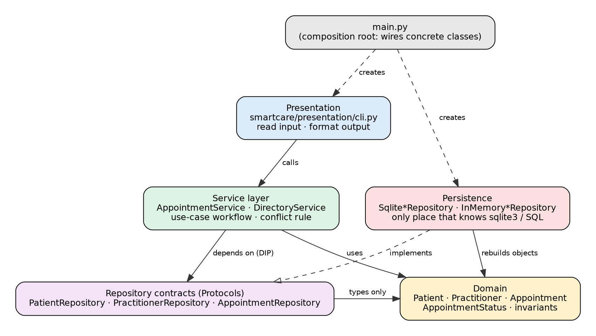

# SmartCare v0.5 - Architecture and Refactoring Workbook

## Current Architecture Problems

| Problem                                                            | Evidence                                                                                  | Impact                                                   | Refactoring                                                 |
|--------------------------------------------------------------------|-------------------------------------------------------------------------------------------|----------------------------------------------------------|-------------------------------------------------------------|
| Business rules, validation and storage mixed in the same functions | smartcare_v02.py: book() validates, checks conflicts and appends to a global list | Rules cannot be tested or changed independently          | Domain objects + service + repository                       |
| Global mutable state                                               | module-level patients dict and appointments list                                          | Hidden coupling; tests must clear globals                | Repositories injected through constructors                  |
| Raw dictionaries and string statuses                               | status stored as "SCHEDULED" in a dict                                                    | Typos accepted silently; rules scattered                 | Domain classes and AppointmentStatus enum (done in Stage 4) |
| Status rule written in a procedural function                       | cancel() in smartcare_v02.py                                                              | Rule can be bypassed by editing the dict                 | Appointment.cancel() owns the rule; service delegates       |
| Cross-appointment conflict rule has no home in v0.4                | One Appointment cannot see other appointments                                             | FR-06 not enforced in the domain model alone             | AppointmentService.book() with a repository query           |
| No storage abstraction                                             | Any saving would put SQL in workflow or domain                                            | Infrastructure coupling; hard to replace or test         | Repository Protocols + SQLite and in-memory implementations |
| No presentation layer                                              | Input and printing live in demo/main blocks                                               | UI mixed with logic; rules untestable without a keyboard | presentation/cli.py with no business rules                  |

## Layer Responsibilities

| Layer        | Responsibilities                                                                                 | Must not contain                             |
|--------------|--------------------------------------------------------------------------------------------------|----------------------------------------------|
| Presentation | Read input, call services, format and display results and error messages                         | Business rules, SQL, repository code         |
| Service      | Coordinate use cases (book, cancel, schedule, history, register); the cross-object conflict rule | sqlite3/SQL, input()/print(), formatting     |
| Domain       | Patient, Practitioner, Appointment, AppointmentStatus and their invariants                       | SQL, input/output, imports from other layers |
| Repository   | Small contracts (Protocols) describing what the services need from storage                       | Implementations, SQL, business rules         |
| Persistence  | SQLite and in-memory implementations of the contracts; rebuilds domain objects                   | Business decisions, UI, workflow             |

## Architecture Diagram

Figure 1 - SmartCare v0.5 architecture. Solid arrows show dependency direction (nothing depends on Presentation or Persistence except main.py); the dashed arrow shows implementation of a contract.

## SOLID Review

| Principle | Relevant? | Evidence                                                                                                                | Decision                         |
|-----------|-----------|-------------------------------------------------------------------------------------------------------------------------|----------------------------------|
| SRP       | Yes       | AppointmentService coordinates appointments only; DirectoryService only registration; the CLI only I/O                  | Keep two services; do not merge  |
| OCP       | Partly    | SQLite was added alongside the in-memory repository without changing any service                                        | Keep; no plugin framework needed |
| LSP       | Yes       | All service tests pass with both repository implementations                                                             | Keep running tests against both  |
| ISP       | Yes       | Three small contracts (2 to 5 methods) instead of one large interface                                                   | Keep small; do not merge         |
| DIP       | Yes       | Services import only domain and contracts; sqlite3 appears only in persistence/sqlite.py (enforced by test_layering.py) | Keep; wiring stays in main.py    |

## AI Architecture Review

| AI suggestion                                | Observed problem?                              | Decision | Reason                                                                      | Verification                                                      |
|----------------------------------------------|------------------------------------------------|----------|-----------------------------------------------------------------------------|-------------------------------------------------------------------|
| Introduce a repository abstraction           | Yes - storage coupling and untestable workflow | Accepted | Directly solves an observed problem.                                        | Services tested with in-memory and SQLite repos; test_layering.py |
| One service per use case / split the manager | Partly                                         | Modified | Two cohesive services are enough; one per method would be over-engineering. | Review of class sizes; all behaviour tests pass                   |
| Microservices                                | No                                             | Rejected | No distributed-system need for a small clinic.                              | Checked against requirements FR-01 to FR-12                       |
| Event bus                                    | No                                             | Rejected | No asynchronous or multi-subscriber requirement.                            | No use case needs it                                              |
| Interface for every class (six interfaces)   | No                                             | Rejected | Only storage needs abstraction.                                             | Kept three repository Protocols only                              |
| Dependency-injection framework               | No                                             | Deferred | Constructor injection in main.py is sufficient at this scale.               | main.py wiring runs; CLI test passes                              |
