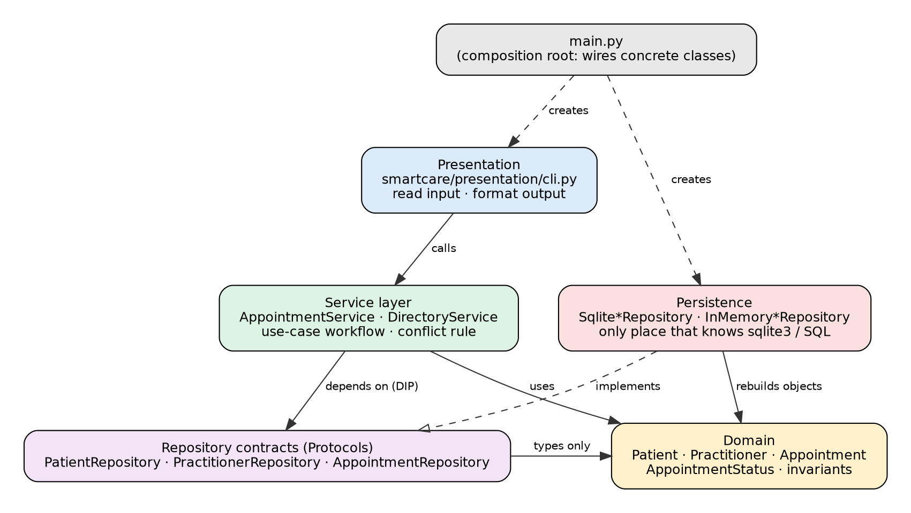

# Stage 5 Lab

HUMAN ANALYSIS -> REFACTOR -> AI REVIEW -> VERIFY | 1 hour

## A - Inspect SmartCare v0.4

Identify domain, workflow, data-access and presentation responsibilities currently mixed together.

**Findings:** the Stage 4 domain is clean (rules only). The mixing is in the earlier procedural prototype (smartcare_v02.py): validation, the conflict rule, status changes and storage in module-level globals are in the same functions, and input/printing sit in the main block. The v0.4 domain also has no home for workflow (the double-booking rule across appointments), storage, or a user interface. Seven problems are listed in the v0.5 workbook.

## B - Propose Architecture

Draw Presentation -> Service -> Domain, with Service using a Repository abstraction and Persistence implementing it.

**Result:** Presentation -> Service -> Domain; Service -> Repository contract; Persistence implements the contract. A composition root (main.py) wires concrete classes.



## C - Create Package Structure

Create domain/, services/, repositories/, persistence/ and presentation/ or a justified equivalent.

**Result:** package structure of Week8/:

```
main.py                       composition root (wires the layers together)
smartcare/
  domain/model.py             Patient, Practitioner, Appointment, AppointmentStatus
  services/                   AppointmentService, DirectoryService, errors
  repositories/contracts.py   three small Protocols (the repository contracts)
  persistence/                memory.py and sqlite.py (only place that uses sqlite3)
  presentation/cli.py         menu, input and output formatting
tests/                        40 tests
```

## D - Introduce AppointmentService

Move workflow coordination into a focused service without stealing Appointment domain behaviour.

**Result:** AppointmentService.book() finds the patient and practitioner, rejects a conflict, creates the Appointment (the domain validates) and saves it. cancel() loads the appointment and calls appointment.cancel(): the domain, not the service, decides whether the transition is legal.

## E - Repository Abstraction

Define a small AppointmentRepository contract using only current use-case needs.

**Result:** AppointmentRepository has five methods, each needed by a current use case: save, find_by_id, find_scheduled_by_practitioner_and_time, list_by_practitioner, list_by_patient. Patients and practitioners get their own two-method contracts (save, find_by_id).

## F - AI Architecture Review

Ask AI to review dependency direction, misplaced responsibilities and unnecessary complexity; request simplest justified improvements.

**What I did:** I gave the AI the package structure and code with the suggested prompt below. In summary it suggested a repository abstraction, splitting services, and then (when asked for more) microservices, an event bus, many interfaces and a DI framework. Each was checked against an observed problem; see the AI Architecture Review table in the v0.5 workbook.

## G - Refactor and Verify

Apply only justified changes and confirm required behaviour remains unchanged.

**Result:** only the repository contracts and two focused services were applied. All behaviour from Stage 4 is unchanged: 40 tests pass (evidence.txt), including service tests run against both in-memory and SQLite repositories, a restart test showing data survives in a database file, a CLI session test, and architecture tests that fail if a layer imports something it should not (checked by deliberately breaking the rule).

## H - Reflection

Document one AI suggestion accepted, one modified and one rejected/deferred.

Accepted: the repository abstraction. The service needed to load and save appointments, and without a contract it would have had to import sqlite3 directly; three small Protocols removed that dependency and let every service test run against both an in-memory and a SQLite repository. Modified: the AI suggested splitting every use case into its own service. I kept only two focused services (AppointmentService for appointment workflow and DirectoryService for registering and finding people), because one service per method would reduce cohesion for a system this small. Rejected/deferred: microservices, an event bus, an interface for every class and a dependency-injection framework. None solves a problem that exists in the current requirements, and constructor injection in main.py is enough. The architecture tests (test_layering.py) show that the dependency direction is enforced, not just drawn, and all 40 tests confirm that the behaviour from Stage 4 is unchanged. The lesson for me is to add structure only where an observed problem justifies it.

## Suggested AI prompt

Act as a software architecture reviewer. Review this small SmartCare Python system against separation of concerns, cohesion, coupling and introductory SOLID principles. Identify concrete layer violations and dependency risks. Prefer the simplest refactoring that solves an observed problem. Do not introduce frameworks, microservices or patterns unless current requirements justify them.

## Evidence (captured output)

Run from the `Week8/` folder. The full log is in [`evidence.txt`](evidence.txt).

```text

$ python -m pytest -v
============================= test session starts ==============================
platform linux -- Python 3.12.3, pytest-9.1.1, pluggy-1.6.0 -- /usr/bin/python
cachedir: .pytest_cache
rootdir: /home/repo/Week8/stage05
collecting ... collected 40 items

tests/test_cli.py::test_full_booking_conflict_and_cancel_flow PASSED     [  2%]
tests/test_cli.py::test_bad_date_and_bad_menu_choice_do_not_crash PASSED [  5%]
tests/test_domain.py::test_valid_objects_are_created PASSED              [  7%]
tests/test_domain.py::test_text_is_trimmed PASSED                        [ 10%]
tests/test_domain.py::test_invalid_patient_rejected[-Alice] PASSED       [ 12%]
tests/test_domain.py::test_invalid_patient_rejected[P1-] PASSED          [ 15%]
tests/test_domain.py::test_invalid_patient_rejected[  -Alice] PASSED     [ 17%]
tests/test_domain.py::test_invalid_patient_rejected[None-Alice] PASSED   [ 20%]
tests/test_domain.py::test_invalid_patient_rejected[P1-None] PASSED      [ 22%]
tests/test_domain.py::test_invalid_practitioner_rejected[args0] PASSED   [ 25%]
tests/test_domain.py::test_invalid_practitioner_rejected[args1] PASSED   [ 27%]
tests/test_domain.py::test_invalid_practitioner_rejected[args2] PASSED   [ 30%]
tests/test_domain.py::test_invalid_practitioner_rejected[args3] PASSED   [ 32%]
tests/test_domain.py::test_appointment_requires_domain_objects_and_datetime PASSED [ 35%]
tests/test_domain.py::test_cancel_scheduled_appointment PASSED           [ 37%]
tests/test_domain.py::test_repeated_cancel_is_illegal_transition PASSED  [ 40%]
tests/test_domain.py::test_status_cannot_be_assigned_from_outside PASSED [ 42%]
tests/test_domain.py::test_patient_is_immutable PASSED                   [ 45%]
tests/test_layering.py::test_dependency_direction_is_respected PASSED    [ 47%]
tests/test_layering.py::test_only_persistence_knows_about_sqlite PASSED  [ 50%]
tests/test_layering.py::test_domain_has_no_io PASSED                     [ 52%]
tests/test_services.py::test_book_creates_scheduled_appointment[in-memory] PASSED [ 55%]
tests/test_services.py::test_book_creates_scheduled_appointment[sqlite] PASSED [ 57%]
tests/test_services.py::test_conflicting_booking_rejected[in-memory] PASSED [ 60%]
tests/test_services.py::test_conflicting_booking_rejected[sqlite] PASSED [ 62%]
tests/test_services.py::test_cancel_retains_history_and_frees_slot[in-memory] PASSED [ 65%]
tests/test_services.py::test_cancel_retains_history_and_frees_slot[sqlite] PASSED [ 67%]
tests/test_services.py::test_repeated_cancel_rejected_by_domain[in-memory] PASSED [ 70%]
tests/test_services.py::test_repeated_cancel_rejected_by_domain[sqlite] PASSED [ 72%]
tests/test_services.py::test_unknown_ids_are_not_found[in-memory] PASSED [ 75%]
tests/test_services.py::test_unknown_ids_are_not_found[sqlite] PASSED    [ 77%]
tests/test_services.py::test_duplicate_appointment_id_rejected[in-memory] PASSED [ 80%]
tests/test_services.py::test_duplicate_appointment_id_rejected[sqlite] PASSED [ 82%]
tests/test_services.py::test_schedule_shows_only_scheduled_sorted_by_time[in-memory] PASSED [ 85%]
tests/test_services.py::test_schedule_shows_only_scheduled_sorted_by_time[sqlite] PASSED [ 87%]
tests/test_services.py::test_patient_history_includes_cancelled[in-memory] PASSED [ 90%]
tests/test_services.py::test_patient_history_includes_cancelled[sqlite] PASSED [ 92%]
tests/test_services.py::test_directory_find_and_duplicates[in-memory] PASSED [ 95%]
tests/test_services.py::test_directory_find_and_duplicates[sqlite] PASSED [ 97%]
tests/test_sqlite_persistence.py::test_data_survives_restart PASSED      [100%]

============================== 40 passed in 0.08s ==============================

$ python main.py :memory: < /tmp/demo_input.txt

SmartCare - Community Clinic Appointment Booking
 1) Register patient          5) Cancel appointment
 2) Find patient              6) Practitioner schedule
 3) Register practitioner     7) Patient appointment history
 4) Book appointment          0) Exit
Choose: Patient ID: Name: Registered patient P1: Alice Smith

SmartCare - Community Clinic Appointment Booking
 1) Register patient          5) Cancel appointment
 2) Find patient              6) Practitioner schedule
 3) Register practitioner     7) Patient appointment history
 4) Book appointment          0) Exit
Choose: Practitioner ID: Name: Specialty: Registered practitioner D1: Dr John Doe (GP)

SmartCare - Community Clinic Appointment Booking
 1) Register patient          5) Cancel appointment
 2) Find patient              6) Practitioner schedule
 3) Register practitioner     7) Patient appointment history
 4) Book appointment          0) Exit
Choose: Date/time (%Y-%m-%d %H:%M): Appointment ID: Patient ID: Practitioner ID: Booked: A1 | 2026-10-08 10:00 | Alice Smith with Dr John Doe | SCHEDULED

SmartCare - Community Clinic Appointment Booking
 1) Register patient          5) Cancel appointment
 2) Find patient              6) Practitioner schedule
 3) Register practitioner     7) Patient appointment history
 4) Book appointment          0) Exit
Choose: Date/time (%Y-%m-%d %H:%M): Appointment ID: Patient ID: Practitioner ID: Error: Practitioner already has an appointment at that time

SmartCare - Community Clinic Appointment Booking
 1) Register patient          5) Cancel appointment
 2) Find patient              6) Practitioner schedule
 3) Register practitioner     7) Patient appointment history
 4) Book appointment          0) Exit
Choose: Practitioner ID: A1 | 2026-10-08 10:00 | Alice Smith with Dr John Doe | SCHEDULED

SmartCare - Community Clinic Appointment Booking
 1) Register patient          5) Cancel appointment
 2) Find patient              6) Practitioner schedule
 3) Register practitioner     7) Patient appointment history
 4) Book appointment          0) Exit
Choose: Appointment ID: Cancelled: A1 | 2026-10-08 10:00 | Alice Smith with Dr John Doe | CANCELLED

SmartCare - Community Clinic Appointment Booking
 1) Register patient          5) Cancel appointment
 2) Find patient              6) Practitioner schedule
 3) Register practitioner     7) Patient appointment history
 4) Book appointment          0) Exit
Choose: Appointment ID: Error: Only scheduled appointments can be cancelled

SmartCare - Community Clinic Appointment Booking
 1) Register patient          5) Cancel appointment
 2) Find patient              6) Practitioner schedule
 3) Register practitioner     7) Patient appointment history
 4) Book appointment          0) Exit
Choose: Patient ID: A1 | 2026-10-08 10:00 | Alice Smith with Dr John Doe | CANCELLED

SmartCare - Community Clinic Appointment Booking
 1) Register patient          5) Cancel appointment
 2) Find patient              6) Practitioner schedule
 3) Register practitioner     7) Patient appointment history
 4) Book appointment          0) Exit
Choose: Goodbye.
```
